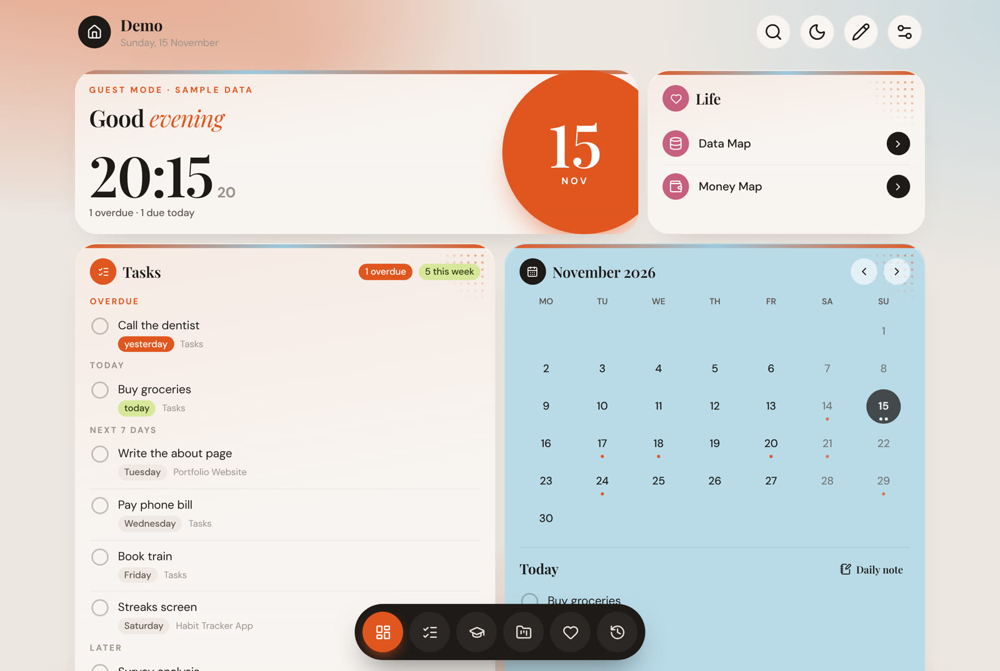
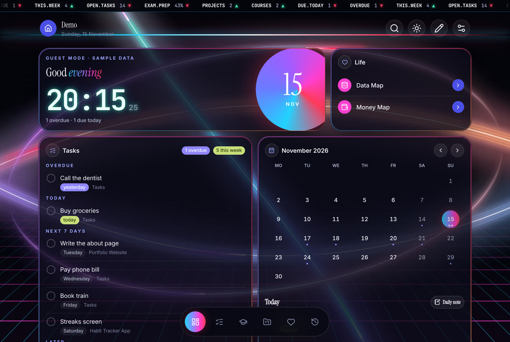
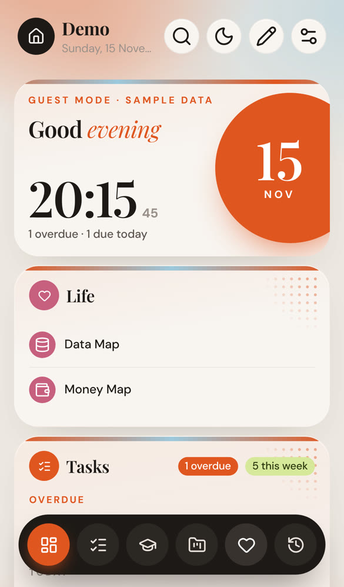
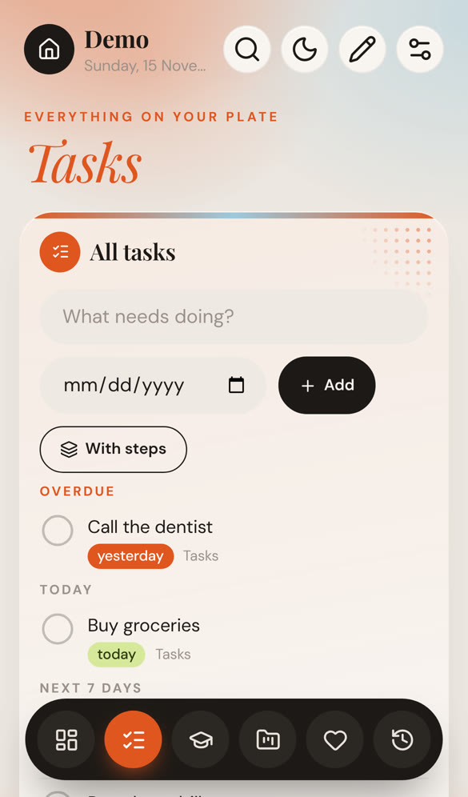
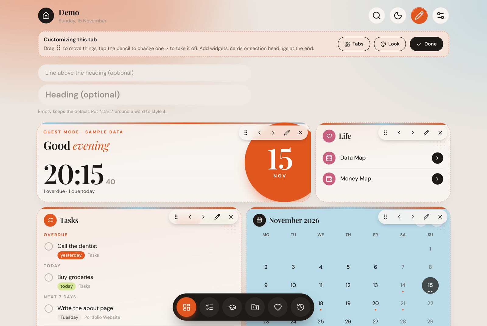

# Personal Dashboard & Tracker

**A self-hosted, phone-first dashboard that turns plain Markdown notes into tasks, a calendar, courses and projects.**
One password, your own Cloudflare account, and a look you can change entirely from the app.




| Hyper theme (dark) | Zeus theme |
|---|---|
|  |  |

| On a phone | Tasks tab | Customize mode |
|---|---|---|
|  |  |  |

*Screenshots use the built-in sample data (guest mode).*

## Why
I kept my life in Markdown notes (projects, courses, exams, daily notes), but notes are a bad home screen. This puts
everything due, every course and every project on one page I can open on my phone, without moving the notes into
someone else's app: **the notes stay plain Markdown** and remain the single source of truth.

## Features
- **Dashboard**: tasks by due date (overdue, today, next 7 days, later), a calendar with Google Calendar events and
  homework from any iCal link, courses with exam study progress, projects, ongoing habits, daily notes, search and a
  note editor. Tasks, due dates, steps and statuses are read from the notes themselves (`- [ ]` lines and front matter).
- **Customizable without code**: every tab is a saved layout. Drag cards, resize them, give any card its own color,
  rename tabs, edit headings and card titles, and add widgets: pictures, sticky notes, countdowns, world clocks,
  weather, links, a note, and **embeds** (paste a link or a site's `<iframe>` code; music **keeps playing across tabs**).
- **Themes**: calm color palettes with your own colors and wallpaper, plus two animated themes: *Hyper* (neon light
  trails or flashing ribbons, with an epilepsy-safe flash rate) and *Zeus* (Greek gods, lightning, and your own
  **video slideshow**). Every theme has light and dark, its own font style, corners and card decoration.
- **Nothing disappears by accident**: undo after ticking or deleting, a 30-day trash for notes, tasks, pictures and
  videos, and conflict checks so an edit on one device never silently overwrites another.
- **Security you can see**: one password, every **signed-in device listed** with log out per device, wrong-password
  attempts recorded, and a warning when a new device signs in.
- **Buddies**: little characters that walk around and jump onto cards, built-in or from your own pictures and GIFs.
- **Guest mode / public demo**: the full app with made-up sample data, answered entirely in the browser.

Full walkthrough: **[docs/GUIDE.md](docs/GUIDE.md)**.

## Engineering highlights
- **Measured before fixing.** The animated theme spent ~1,800 ms drawing per second (Chrome tracing). Rebuilt to animate
  only `transform` and `opacity`: **~4 ms per second**.
- **Phone graphics memory.** An iPhone crash loop came from full-screen layers kept at 3x pixel density (an estimated
  ~684 MB). Bands are now drawn once into small canvases, one slide is on the page at a time, and the page turns
  animations off by itself after repeated crashes.
- **Free-plan limits.** Cloudflare's free plan allows 10 ms of CPU per request. Decoding a 1 MB picture went from
  ~110 ms to ~0.5 ms; videos are stored in 1 MB parts and served as byte ranges, one part per request (which iPhones
  require anyway).
- **Embeds that survive navigation.** An `<iframe>` that leaves the page stops, and moving one reloads it. Players live in
  one layer that never unmounts and are laid over their card's placeholder every frame.
- **Sessions you can revoke.** Each login is a database row behind an HMAC-signed cookie, so every device is visible and
  can be logged out from any other.

## Stack and architecture
- **Next.js 16 + React 19** (App Router), plain CSS, no UI library.
- Hosted on **Cloudflare Workers** through the OpenNext adapter; data in **Cloudflare D1** (SQLite).
- **One small API** (`lib/server.js`): notes, settings, pictures, videos, trash, sessions and calendar links. Layout,
  themes and widgets are settings stored as JSON, so the dashboard is rearranged in the app, not in code.
- Fits the **free plan**: a few requests per visit, about one database row read per note, under 10 ms CPU per request.

## Get started (your own copy)
You need Node.js 20+ and a free Cloudflare account.

```bash
git clone https://github.com/kookithub/Personal-dashboard-and-tracker.git
cd Personal-dashboard-and-tracker
npm install
npx wrangler login
npm run setup
```

`npm run setup` creates your database, publishes the site to `https://home-dashboard.<your-subdomain>.workers.dev`
and asks for your password. Your notes and settings start empty and stay in your own Cloudflare account.

- **Bring your Obsidian notes** (optional): `npm run import -- "/path/to/your/vault"`, then
  `npx wrangler d1 execute home-dashboard --remote --file seed.sql`. Folders it reads: `Projects`, `Academic`, `Life`,
  `Daily`, `Templates` (rename them in `components/board.jsx` if yours differ).
- **Deploy on every push** (optional): Cloudflare > Workers & Pages > `home-dashboard` > Settings > Build, and connect
  your GitHub repository.
- **Run it locally**: create `.dev.vars` with `APP_PASSWORD=...` and `SESSION_SECRET=...` (any long random text), run
  `npx wrangler d1 execute home-dashboard --local --file schema.sql` once, then `npm run dev` and open
  `http://localhost:3000`.

## Commands
- `npm run dev`: run locally (Node). `npm run preview`: run the built Cloudflare version locally.
- `npm run setup`: one-time Cloudflare setup. `npm run deploy`: build and publish.
- `npm run deploy:demo`: publish the **public demo** (`wrangler.demo.jsonc`, worker `dashboard-demo`): sample data only,
  no password screen, no database, no secrets. `npm run build:demo` only builds it.
- `npx wrangler secret put APP_PASSWORD`: change the password. `npx wrangler secret put SESSION_SECRET`: log every
  device out.
- `npm run import`: build `seed.sql` from an Obsidian vault. `npm run icons`: remake the default icons.
- `node scripts/smoke-test.mjs <url>` / `node scripts/check-live.mjs <url>`: quick checks of a running or deployed site.

## Project structure
- `app/globals.css`: **the whole design** (colors, fonts, cards, dock, phone layout). Start here to change the look.
- `app/layout.jsx`: fonts and page setup (the page description used in link previews is here).
- `lib/layout.js`: tabs, page headings, built-in cards and their default texts, saved layouts.
- `components/Dashboard.jsx`: draws the open tab, customize mode (drag, edit, add), and the built-in cards.
- `components/widgets.jsx`: the widgets and the add/edit widget dialog. `components/Logo.jsx`: the logo.
- `components/tiles.jsx`: the cards themselves (clock, stats, calendar, courses, tasks…).
- `components/SettingsDialog.jsx`, `SearchDialog.jsx`, `NotePage.jsx`, `Markdown.jsx`, `Gate.jsx` (login).
- `components/AppProvider.jsx`: loading and saving notes, settings, calendar, theme, the moving-background switch and crash fallback.
- `components/SkinBackdrop.jsx`: Hyper's and Zeus' moving backgrounds. `components/Buddy.jsx`: the buddies.
- `components/EmbedHost.jsx`: keeps embedded players (Spotify, YouTube…) playing across tabs. `components/DevicesDialog.jsx`: signed-in devices.
- `lib/`: note parsing and task edits (`notes.js`), calendar links (`ical.js`), palettes, font styles and backgrounds (`theme.js`),
  and the server API (`server.js`, used by `app/api/[...route]/route.js`).

More notes for working on the code: **[docs/DEVELOPMENT.md](docs/DEVELOPMENT.md)**.

## Your data

The repository holds only code. When you run your own copy, your data lives in three places, all yours:

- **Cloudflare D1 database** (`home-dashboard`, in your Cloudflare account): every note and task, the dashboard
  settings (themes, layout, widgets, buddies, calendar links, the task bin), uploaded pictures (the `blobs` table),
  signed-in devices (`sessions`: device, IP address, city/country, times) and wrong-password attempts (`login_log`, 30
  days; `login_fails`, 15 minutes, for rate limiting).
- **Cloudflare Worker secrets**: the password (`APP_PASSWORD`) and the key that signs logins (`SESSION_SECRET`).
  They are never in the code and can't be read back, only replaced.
- **Each browser** (local storage, per device): light/dark, moving background on/off, the open tab, folded sections, and short-lived caches
  of calendar events and weather. No notes.

Settings > Account > **Download backup** saves all notes and settings as one JSON file.

## Security
- **One password**, checked on the server only. It's compared as HMACs, so the time taken doesn't hint at the
  password, and it's stored as a Cloudflare Worker secret, never in the code.
- **Sessions**: each login is a row in the database (device, place, times) and the cookie holds its id, signed with a
  separate secret (HMAC), `HttpOnly`, `Secure`, `SameSite=Strict`, 90 days. Every API route checks the signature, then
  that the row still exists, so **every signed-in device is listed** in Settings > Account and can be logged out from
  any other. Wrong passwords are recorded too, and the app warns about new sign-ins.
- **Rate limiting**: 8 wrong passwords per IP address in 15 minutes, then the login waits.
- **Writes only from the site itself** (the request's origin is checked) on top of the same-site cookie.
- **Input checks**: note paths can't climb out of the notes (`..` refused), notes are capped at 1 MB, uploads must be
  images and are size-limited, calendar links are fetched by the server so they never sit in the browser.
- **No silent overwrites**: each save says which version it started from; if the note changed on another device in
  the meantime, the save is refused and the newest version shown.
- **Notes can't run code**: HTML in a note is cleaned (DOMPurify) before it's shown, so a script or `onerror=`
  hidden in a pasted or imported note does nothing; safe HTML (`<details>`, ``…) stays. Uploads are limited to
  PNG, JPEG, GIF, WebP and AVIF (no SVG), and pictures are served sandboxed so they can never act as a page.
- **Security headers** on every response (`next.config.mjs`): the site can't be shown inside another site's frame,
  no plugins, files are never "sniffed" as another type, other sites only see the site address as referrer, and no
  camera, microphone or location access.
- **Nothing personal in the repo**: notes, settings, pictures and secrets live in Cloudflare (see "Where the data is
  kept"). **Guest mode** answers every request in the browser, so a guest never reaches the server or any real data.

## Engineering notes: problems found and how they were fixed
- **A finished project vanished.** Setting a project to "done" hid it with no way back in the app (status was only
  editable in the raw note). Now there's a status switch on the note and a "Done & paused" section.
- **Data loss in the trash.** Two notes with the same name deleted on the same day overwrote each other. Trash entries
  now get a unique name and keep their original folder, so they can be restored where they were.
- **Pictures failed on the free plan.** Decoding a 1 MB picture character by character took ~110 ms of CPU against a
  10 ms limit per request. A native decoder does it in ~0.5 ms.
- **Old pictures were kept forever.** Replaced wallpapers and removed widgets left their pictures in the database. The
  server now finds pictures nothing uses, moves them to the Trash, and deletes them after 30 days.
- **Hyper was unusably laggy.** Chrome tracing showed ~1,800 ms of drawing per second: more than a second can hold.
  Causes: blur behind glass cards over a moving background, animated color filters, SVG animation inside large
  images, and gradients redrawn every frame. Everything was rebuilt to only move or fade (CSS `transform` and
  `opacity`, which the graphics chip handles): **~4 ms per second**. Zeus went from ~52 to ~2.
- **The site crashed on iPhone and kept reloading.** Safari ran out of graphics memory: every moving full-screen layer
  is kept at the screen's 3x pixel density (~58 MB each), and Hyper had up to 18 of them; an entrance animation also
  kept every card and the whole page as separate layers for good. Estimated graphics memory on an iPhone screen:
  Hyper 684 MB, Zeus 363 MB. Fixes: bands are drawn once into small canvases (~1.6 MB each), Zeus' pictures are shown
  at their own size, the entrance animation lets go when it ends, and per-card animations stay on one card. If a phone
  still crashes three times in a row right after opening, moving backgrounds switch off on that device and say so.
  Phones get a lighter Zeus. (For a while iPhones showed Hyper as Zeus; that swap was removed to keep settings simple:
  the one "Moving background on this device" switch, plus the crash fallback, covers it.)
- **Flashing had to be safe and still adjustable.** Ribbon flashing is set in flashes per second per band; up to 3 is
  the usual limit for photosensitive epilepsy, so going higher shows a warning and asks first, and reduced motion turns
  flashing off.
- **A styling detail silently did nothing.** The canvas component that draws the bands dropped the per-band timing, so
  every flash layer ran on the same default rhythm. Found while adding the flash rate; fixed.
- **Themes were inconsistent.** Fonts and colors applied only to some looks, and Hyper/Zeus overrode everything as
  "modes". Rebuilt so every theme has light and dark, and font, corners, decoration and cards work in any theme.
- **Theme settings grew too complicated.** A base-theme picker, a filtered theme list, per-phone overrides and a long
  list of sliders. Simplified to one grouped theme list, one "Customize" section, the sliders folded away, and one
  per-device moving background switch.

## How it grew
1. Audit and fixes: finished projects visible, trash and undo, no data loss.
2. Customizable tabs, layouts, widgets and the picture widget.
3. Buddies, then several at once, a picture library, pixel characters.
4. Free-plan check: picture decoding over the CPU limit, fixed.
5. 30-day bin for notes, tasks and pictures.
6. Hyper and Zeus, then the theme rework (base themes, light and dark, per-theme styles).
7. The lag hunt (drawing time) and the crash hunt (graphics memory), each measured before and after.
8. Guest mode, README for reuse, ribbons with chosen colors and a safe flash rate, iPhone defaults.
9. Simpler theme settings, undeletable base themes, your own texts for headings, card titles and greetings.
10. Security pass; your own video slideshow for Zeus; embed widgets take pasted embed code.
11. Signed-in devices with remote log out and sign-in alerts; embeds that keep playing across tabs; a public demo build.

## License
[MIT](LICENSE) © kookithub
