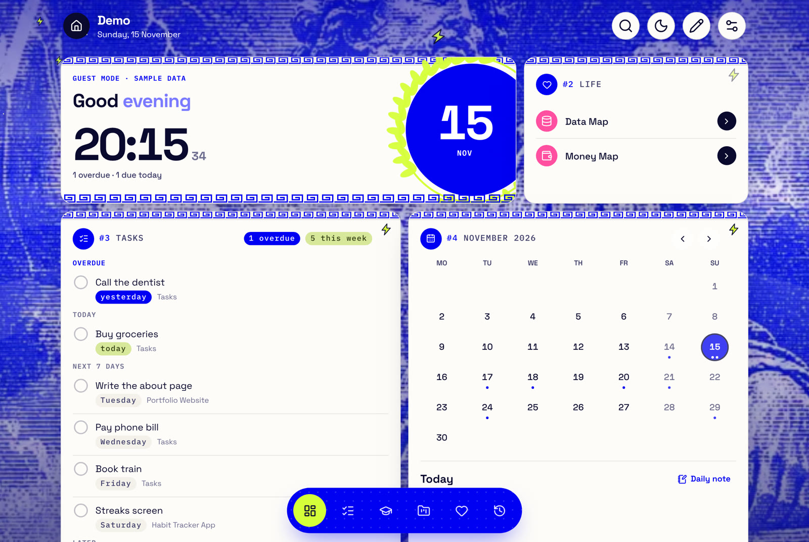
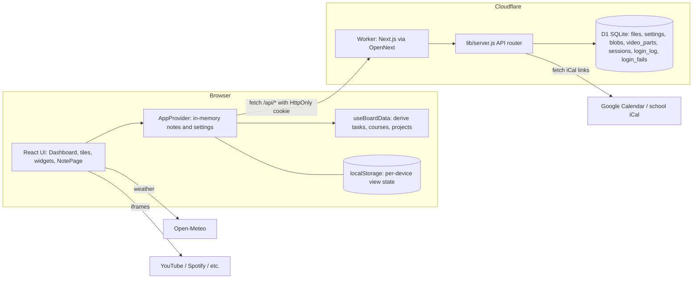

# Personal Dashboard & Tracker

**A self-hosted, phone-first dashboard that turns plain Markdown notes into tasks, a calendar, courses and projects.**
One password, your own Cloudflare account, and a look you can change entirely from the app.


| Hyper theme (dark) | Zeus theme |
|---|---|
|  |  |

| On a phone | Tasks tab | Customize mode |
|---|---|---|
|  |  |  |

*Screenshots use the built-in sample data (guest mode).*

## Why
I kept my life in Markdown notes (projects, courses, exams, daily notes), but notes are a bad home screen. This puts
everything due, every course and every project on one page I can open on my phone, without moving the notes into
someone else's app: **the notes stay plain Markdown** and remain the single source of truth.

## Table of contents
Features · Tech stack · Architecture · How it works · Results and outputs · Get started · Commands · Repository structure · Data and storage · Security · Engineering notes · Project Facts (for resume)

## Features
Everything below exists in the code; nothing is planned or mocked. The app has **no separate "tracker" modules**: tasks,
courses, exam study progress, projects and ongoing habits are all *derived from Markdown notes*, and the visible
dashboard is built from **14 built-in cards** and **9 widget types** arranged on **6 default tabs**.

### Notes and the note editor
- **Markdown notes are the source of truth** (`files` table: path, content, mtime). Folders are found by name anywhere in the
  tree (`Projects`, `Academic`, `Life`, `Life/Ongoing`, `Daily`, `Templates`), so they still work after being moved.
- **Reader and editor** (`components/NotePage.jsx`): read a note and tick its tasks, or edit raw Markdown. `Ctrl/Cmd+S` saves;
  `Tab` inserts a tab character so sub-tasks can be typed; leaving with unsaved changes asks first.
- **Markdown rendering** (`marked` + `DOMPurify`): GitHub-flavoured Markdown, `[[wiki links]]` (with `|alias` and `#heading`
  parts) resolved to real notes, tickable task checkboxes, sanitised HTML (`<details>`, ``...). Due dates written in a
  note are shown as labels. A `dataview` block in a daily note is replaced by a "due today" list of tasks.
- **Front matter** (`status`, `code`, `area`, `deadline`, `started`...) is parsed by a small hand-written YAML reader
  (key/value and `- item` lists) in `lib/notes.js`.
- **Search** (`SearchDialog.jsx`): searches note names and full text (name matches rank above text matches, 40 results,
  snippet around the hit), or creates a new note from the query.
- **Templates**: `Templates/Project`, `Course`, `Daily` notes with `{{title}}`, `{{date}}`, `{{date:FORMAT}}`, `{{time}}` placeholders (`fillTemplate`).
- **Daily notes**: created from the calendar (click a day) as `Daily/YYYY-MM-DD.md`.
- **Conflict-safe saving**: every save sends the version (`mtime`) it started from; a mismatch returns HTTP 409 and the newest version.

### Tasks and due dates
- **Task syntax**: `- [ ] Name [due:: 2026-11-20]` with indented sub-tasks (step trees), ignoring fenced code blocks; each task
  remembers its source file, line number, section heading, parent and children (`parseTasks`).
- **Line-level edit functions** (`edit.done / rename / due / remove / addStep / setProp / restoreTask / appendUnder`): a task
  change rewrites just that line (or block) of the note text.
- **Home "Tasks" card and "All tasks" card**: overdue, due today, next 7 days, later, no date, and a folded **Done** group; quick
  add with optional date; **"With steps"** dialog to create a parent task plus steps; rename, re-date, add step, delete.
- **"Tasks with steps" card**: every task that has sub-tasks, with its progress.
- **Undo** after ticking or deleting a task; deleted tasks (with steps) go to a 30-day **task bin** that remembers the heading
  and parent they came from, and can be restored there (or to the `Life/Tasks.md` inbox if the note is gone).

### Study (courses and exams)
- **Courses** from `Academic/*.md`; tasks under an "Exam" heading are treated as **exam study steps**, kept apart from ordinary tasks.
- **Exam prep card**: a progress ring (done steps / total steps across active courses).
- **Courses / Courses with exams cards**: per-course progress, exams with dated study steps, project items; finished exams are folded.
- **Homework card**: events from school iCal links (Canvas, Moodle, Blackboard, Schoology-style URLs auto-detected), each tickable;
  ticked items whose day has passed fold behind "Show N finished" (`hw_done`, `hw_since` settings).
- **Status switch** on course/project/ongoing notes (active, paused, done, archived; many synonyms count as inactive).
  Inactive notes move to their own section ("Past courses", "Done & paused projects", "Stopped & paused"), never hidden.

### Projects and life
- **Projects card** (`Projects/*.md`): tiles with task progress, inline rename, status; separate "Done & paused" section.
- **Ongoing card** (`Life/Ongoing/*.md`): habits/long-running things, with the same status handling.
- **Life links**: configurable `Name | note | icon` shortcuts (defaults: Data Map and Money Map notes), as small or big tiles.
- **Recently edited card**: notes by modified time, "Clear list" / "Show all" (per-device), and a link to the Trash.

### Calendar
- **Calendar card**: month grid with dots for daily notes, due tasks/exams and calendar events; select a day to list its tasks,
  exams and events; open or create that day's daily note.
- **iCal integration** (`lib/ical.js`, `/api/ical`): server fetches Google Calendar secret links and homework links; a custom
  parser handles `VEVENT`, `RRULE` (DAILY/WEEKLY/MONTHLY/YEARLY, `INTERVAL`, `COUNT`, `UNTIL`, `BYDAY`), `EXDATE`, cancelled events, alarms
  and folded lines, expanding events over a window of 2 months back to 6 months ahead. Results cached in the browser for 30 minutes.

### Widgets (add to any tab)
Picture (shapes: as is, square, wide, tall, fill; focus point), text / sticky note, countdown, world clock (time-zone), weather
(Open-Meteo geocoding and forecast, WMO codes, cached 30 min), links, note (shows a note's content), **embed** and section heading.
- **Embed widget**: paste a link or a site's `<iframe>`/blockquote embed code. Only the address and height are kept (never the pasted
  code). Known sites are rewritten to embed URLs: YouTube (incl. shorts, playlists, start time), Spotify, Vimeo, TikTok, Instagram,
  X/Twitter, SoundCloud, Apple Music, Google Docs/Sheets/Slides/Forms, Google Maps places.
- **Players keep playing across tabs and notes** (`EmbedHost.jsx`): iframes live in one never-unmounted layer and are positioned
  over a placeholder each animation frame; a floating music button brings the player back with a Stop control.

### Customisation without code
- **Tabs**: 6 built-in (Home, Tasks, Study, Projects, Life, Recent) plus your own; rename, reorder, pick from 32 icons, hide from the dock.
- **Layout editor**: drag to reorder, resize (widths on a 6-column grid, separate phone widths), move cards between tabs, per-card box
  colour (theme, glass, clear, 6 colours), editable page headings and card titles, greetings per time of day (`*word*` = coloured italics).
- Layout lives in the `dashboard` setting as JSON (`lib/layout.js`), so a rearranged dashboard needs no deploy.

### Themes and look
- **10 palettes** (Classic/terracotta, Sage, Ocean, Rose, Plum, Forest, Sunset, Lagoon, Cherry, Mono), each with light and dark; custom colours,
  wallpaper picture or 5 backdrop patterns (Glow, Plain, Mesh, Dots, Grid); **6 font styles**, **3 corner styles**, **6 card decorations**,
  **3 card materials** (solid, glass, clear). Copy any theme to make your own.
- **Hyper** (animated): neon-trail or ribbon bands (5 colour sets), live ticker, strobe/scan line/grid floor options, flash-rate limit with a
  photosensitivity warning above 3 flashes/s, reduced-motion support.
- **Zeus** (animated): 7 bundled images, lightning, sparks, floating bolts, and your **own slideshow** of uploaded pictures and videos (up to 30 MB each).
- **Custom logo** (icon, text/emoji or picture) that also generates the home-screen icons (PWA manifest + apple-touch-icon).
- **Buddies**: up to 6 characters (pixel cat, pixel bunny, blob, cat, ghost, or your own picture/GIF/sprite strip) with motions (explore, walk,
  wander, peek, bounce), 3 activity levels, 3 speeds, size, custom speech lines with `{due}` / `{overdue}` placeholders.

### Accounts, safety and recovery
- Single password, **signed-in devices list** with per-device and "all others" logout, wrong-password log, new-sign-in warning.
- **Trash** (30 days) for notes, tasks, pictures and videos; unused uploads are auto-binned by a periodic tidy-up.
- **Download backup** (all notes and settings as one JSON file).
- **Guest mode** and a **public demo build** with made-up sample data answered fully in the browser.
- Installable as a home-screen web app (`manifest.webmanifest`, icons).

### Keyboard shortcuts
There are no global shortcuts. Local keys: `Ctrl/Cmd+S` save a note; `Tab` indent in the editor; `Enter`/`Space` toggle checkboxes and
fold sections; `Enter` submits quick-add boxes and renames; `Escape` closes dialogs.

## Tech stack
| Area | Used |
|---|---|
| Framework | Next.js 16.4 (App Router, Turbopack) with React 19, JavaScript (JSX, no TypeScript apart from `open-next.config.ts`) |
| Libraries | `marked` (Markdown), `dompurify` (HTML sanitising), `moment` (dates), `lucide-react` (icons) |
| Styling | One hand-written stylesheet, `app/globals.css` (3,223 lines), CSS variables for themes; no UI library |
| Hosting | Cloudflare Workers via `@opennextjs/cloudflare`; `wrangler` CLI |
| Database | Cloudflare D1 (SQLite), 7 tables (`schema.sql`) |
| External services | Google Calendar / school iCal feeds (user-supplied URLs), Open-Meteo (weather), embed hosts (YouTube, Spotify, etc.) |
| Config (placeholders only) | secrets `APP_PASSWORD`, `SESSION_SECRET`; optional build vars `NEXT_PUBLIC_DEMO`, `NEXT_PUBLIC_REPO_URL` |

## Architecture


## How it works
1. **Load**: after login the browser calls `GET /api/files`, receiving every note and every setting in one response; they are kept in
   memory (`AppProvider`). A periodic server "tidy-up" (at most every 6 hours) runs on this call.
2. **Derive**: `useBoardData` (`components/board.jsx`) parses all notes into pages and tasks, then computes overdue / today / this week /
   later lists, exam study progress, active vs inactive courses, projects and ongoing notes, and calendar marks. Nothing is stored twice.
3. **Edit**: ticking, renaming or re-dating a task calls `processFile(path, fn)`, which applies a pure line edit to the note text and saves it
   through `PUT /api/files` with the base version for conflict detection. Undo restores the previous text if the note has not changed since.
4. **Layout and look** are JSON settings (`PUT /api/settings`); card/widget components are looked up in `CARD_VIEWS` and `WIDGET_TYPES`.
5. **Uploads**: pictures go in as base64 rows in `blobs` (served immutable and sandboxed); videos are uploaded in 1 MB parts and served as
   HTTP byte ranges, one part per request.
6. **Calendars** are fetched server-side so links never sit in the browser; the client expands recurrences and caches for 30 minutes.
7. **Guest mode** swaps `fetch` for an in-memory handler (`guestReply`) so no request reaches the server.

## Results and outputs
- A deployed Cloudflare Worker (`home-dashboard`) with a D1 database, or a database-free public demo Worker (`dashboard-demo`).
- Production build verified for this README with `npx next build` (Next.js 16.4.6): compiles, 4 routes (`/` static, `/note/[...path]` and
  `/api/[...route]` dynamic). Client JavaScript in `.next/static`: about 925 KB uncompressed (about 287 KB gzipped, summed per file), CSS about 110 KB.
- Output files: home-screen icons (`public/*.png`), `seed.sql` (generated import, git-ignored), JSON backup downloaded from the app.
- There is no automated test suite; `scripts/smoke-test.mjs` and `scripts/check-live.mjs` are manual HTTP checks.

## Get started (your own copy)
You need Node.js 20+ and a free Cloudflare account.

```bash
git clone https://github.com/kookithub/Personal-dashboard-and-tracker.git
cd Personal-dashboard-and-tracker
npm install
npx wrangler login
npm run setup
```

`npm run setup` creates your database, publishes the site to `https://home-dashboard.<your-subdomain>.workers.dev`
and asks for your password. Your notes and settings start empty and stay in your own Cloudflare account.

- **Bring your Obsidian notes** (optional): `npm run import -- "/path/to/your/vault"`, then
  `npx wrangler d1 execute home-dashboard --remote --file seed.sql`. Folders it reads: `Projects`, `Academic`, `Life`,
  `Daily`, `Templates` (rename them in `components/board.jsx` if yours differ).
- **Deploy on every push** (optional): Cloudflare > Workers & Pages > `home-dashboard` > Settings > Build, and connect
  your GitHub repository.
- **Run it locally**: create `.dev.vars` with `APP_PASSWORD=...` and `SESSION_SECRET=...` (any long random text), run
  `npx wrangler d1 execute home-dashboard --local --file schema.sql` once, then `npm run dev` and open
  `http://localhost:3000`.

## Commands
- `npm run dev`: run locally (Node). `npm run preview`: run the built Cloudflare version locally.
- `npm run setup`: one-time Cloudflare setup. `npm run deploy`: build and publish.
- `npm run deploy:demo`: publish the **public demo** (`wrangler.demo.jsonc`, worker `dashboard-demo`): sample data only,
  no password screen, no database, no secrets. `npm run build:demo` only builds it.
- `npx wrangler secret put APP_PASSWORD`: change the password. `npx wrangler secret put SESSION_SECRET`: log every
  device out.
- `npm run import`: build `seed.sql` from an Obsidian vault. `npm run icons`: remake the default icons.
- `node scripts/smoke-test.mjs <url>` / `node scripts/check-live.mjs <url>`: quick checks of a running or deployed site.

## Repository structure
```
app/            layout.jsx, page.jsx, note/[...path]/page.jsx, api/[...route]/route.js, globals.css (whole design)
components/     20 React files: AppProvider, Dashboard, tiles, widgets, board, NotePage, Markdown, SearchDialog, SettingsDialog,
                SkinBackdrop (Hyper/Zeus), Buddy, EmbedHost, DevicesDialog, TrashDialog, Gate, Logo, ui
lib/            notes.js (parsing and edits), layout.js, theme.js, ical.js, server.js (API), demo.js (guest data)
scripts/        setup-cloudflare, import-vault, demo, make-icons, smoke-test, check-live
public/         icons, manifest, skins/zeus (7 webp images)
docs/           GUIDE.md (user guide), DEVELOPMENT.md (dev notes), screenshots/ (6 existing images)
schema.sql, wrangler.jsonc, wrangler.demo.jsonc, open-next.config.ts, next.config.mjs
```
Longer file-by-file notes: **[docs/DEVELOPMENT.md](docs/DEVELOPMENT.md)**; user walkthrough: **[docs/GUIDE.md](docs/GUIDE.md)**.

## Data and storage
The repository holds only code. At runtime:
- **D1 tables** (`schema.sql`): `files` (notes), `blobs` (pictures, video metadata, icons; `trashed_at`), `settings` (key -> JSON),
  `video_parts` (1 MB base64 parts), `sessions`, `login_log` (30 days), `login_fails` (15-minute rate limit). Settings keys used:
  `dashboard`, `task_bin`, `gcal_urls`, `hw_urls`, `hw_done`, `hw_since`, `icon_sig`, `tidied_at`.
- **Worker secrets**: `APP_PASSWORD`, `SESSION_SECRET` (never in code).
- **Browser localStorage** (per device, no notes): `k-theme`, `k-look`, `k-pal2`, `k-tab`, `k-home-scroll`, `k-fold-*`, `k-open-*`, `k-motion`,
  `k-motion-auto`, `k-boot`, `k-recent-since`, `k-signin-check`, `k-gcal-cache`, `k-wx-<city>`.
- **Offline**: no service worker or offline queue; the app needs the network (the guest demo works without the server). **Import/export**:
  Obsidian vault import (`npm run import`), JSON backup download.

## Security
- **One password**, checked on the server only. It's compared as HMACs, so the time taken doesn't hint at the
  password, and it's stored as a Cloudflare Worker secret, never in the code.
- **Sessions**: each login is a row in the database (device, place, times) and the cookie holds its id, signed with a
  separate secret (HMAC), `HttpOnly`, `Secure`, `SameSite=Strict`, 90 days. Every API route checks the signature, then
  that the row still exists, so **every signed-in device is listed** in Settings > Account and can be logged out from
  any other. Wrong passwords are recorded too, and the app warns about new sign-ins.
- **Rate limiting**: 8 wrong passwords per IP address in 15 minutes, then the login waits.
- **Writes only from the site itself** (the request's origin is checked) on top of the same-site cookie.
- **Input checks**: note paths can't climb out of the notes (`..` refused), notes are capped at 1 MB, uploads must be
  images and are size-limited, calendar links are fetched by the server so they never sit in the browser.
- **No silent overwrites**: each save says which version it started from; if the note changed on another device in
  the meantime, the save is refused and the newest version shown.
- **Notes can't run code**: HTML in a note is cleaned (DOMPurify) before it's shown, so a script or `onerror=`
  hidden in a pasted or imported note does nothing; safe HTML (`<details>`, ``…) stays. Uploads are limited to
  PNG, JPEG, GIF, WebP and AVIF (no SVG), and pictures are served sandboxed so they can never act as a page.
- **Security headers** on every response (`next.config.mjs`): the site can't be shown inside another site's frame,
  no plugins, files are never "sniffed" as another type, other sites only see the site address as referrer, and no
  camera, microphone or location access.
- **Nothing personal in the repo**: notes, settings, pictures and secrets live in Cloudflare (see "Where the data is
  kept"). **Guest mode** answers every request in the browser, so a guest never reaches the server or any real data.

## Engineering notes: problems found and how they were fixed
- **A finished project vanished.** Setting a project to "done" hid it with no way back in the app (status was only
  editable in the raw note). Now there's a status switch on the note and a "Done & paused" section.
- **Data loss in the trash.** Two notes with the same name deleted on the same day overwrote each other. Trash entries
  now get a unique name and keep their original folder, so they can be restored where they were.
- **Pictures failed on the free plan.** Decoding a 1 MB picture character by character took ~110 ms of CPU against a
  10 ms limit per request. A native decoder does it in ~0.5 ms.
- **Old pictures were kept forever.** Replaced wallpapers and removed widgets left their pictures in the database. The
  server now finds pictures nothing uses, moves them to the Trash, and deletes them after 30 days.
- **Hyper was unusably laggy.** Chrome tracing showed ~1,800 ms of drawing per second: more than a second can hold.
  Causes: blur behind glass cards over a moving background, animated color filters, SVG animation inside large
  images, and gradients redrawn every frame. Everything was rebuilt to only move or fade (CSS `transform` and
  `opacity`, which the graphics chip handles): **~4 ms per second**. Zeus went from ~52 to ~2.
- **The site crashed on iPhone and kept reloading.** Safari ran out of graphics memory: every moving full-screen layer
  is kept at the screen's 3x pixel density (~58 MB each), and Hyper had up to 18 of them; an entrance animation also
  kept every card and the whole page as separate layers for good. Estimated graphics memory on an iPhone screen:
  Hyper 684 MB, Zeus 363 MB. Fixes: bands are drawn once into small canvases (~1.6 MB each), Zeus' pictures are shown
  at their own size, the entrance animation lets go when it ends, and per-card animations stay on one card. If a phone
  still crashes three times in a row right after opening, moving backgrounds switch off on that device and say so.
  Phones get a lighter Zeus. (For a while iPhones showed Hyper as Zeus; that swap was removed to keep settings simple:
  the one "Moving background on this device" switch, plus the crash fallback, covers it.)
- **Flashing had to be safe and still adjustable.** Ribbon flashing is set in flashes per second per band; up to 3 is
  the usual limit for photosensitive epilepsy, so going higher shows a warning and asks first, and reduced motion turns
  flashing off.
- **A styling detail silently did nothing.** The canvas component that draws the bands dropped the per-band timing, so
  every flash layer ran on the same default rhythm. Found while adding the flash rate; fixed.
- **Themes were inconsistent.** Fonts and colors applied only to some looks, and Hyper/Zeus overrode everything as
  "modes". Rebuilt so every theme has light and dark, and font, corners, decoration and cards work in any theme.
- **Theme settings grew too complicated.** A base-theme picker, a filtered theme list, per-phone overrides and a long
  list of sliders. Simplified to one grouped theme list, one "Customize" section, the sliders folded away, and one
  per-device moving background switch.

## How it grew
1. Audit and fixes: finished projects visible, trash and undo, no data loss.
2. Customizable tabs, layouts, widgets and the picture widget.
3. Buddies, then several at once, a picture library, pixel characters.
4. Free-plan check: picture decoding over the CPU limit, fixed.
5. 30-day bin for notes, tasks and pictures.
6. Hyper and Zeus, then the theme rework (base themes, light and dark, per-theme styles).
7. The lag hunt (drawing time) and the crash hunt (graphics memory), each measured before and after.
8. Guest mode, README for reuse, ribbons with chosen colors and a safe flash rate, iPhone defaults.
9. Simpler theme settings, undeletable base themes, your own texts for headings, card titles and greetings.
10. Security pass; your own video slideshow for Zeus; embed widgets take pasted embed code.
11. Signed-in devices with remote log out and sign-in alerts; embeds that keep playing across tabs; a public demo build.

## Project Facts (for resume)
Plain facts only, verified from the code and git history. Items marked TODO need the owner.

- **Course / class**: none indicated in the repository. TODO: confirm (personal project?).
- **Solo or team**: git history shows a single author (`kookithub`), 2 commits, both on 2026-11-15. No other contributors in the log. TODO: confirm whether anyone else contributed outside git.
- **My contributions (git)**: commit 1 "Personal Dashboard & Tracker": 65 files, 16,198 insertions (includes lockfile, CSS, docs, 6 screenshots, 7 skin images). Commit 2 "Due dates in notes as labels, Hyper glow default, idle player layer": 4 files, 12 insertions, 2 deletions. Everything in the repository is attributed to this one author. TODO: confirm the project timeline before 2026-11-15 (history appears squashed into the first commit).
- **Languages / frameworks / libraries**: JavaScript (JSX), CSS, SQL, one TypeScript config file; Next.js 16.4.6, React 19.3.1, marked 18.2.0, DOMPurify 3.4.17, moment 2.30.1, lucide-react 1.72.0; dev: @opennextjs/cloudflare 1.20.16, wrangler 4.160.0; Cloudflare Workers + D1.
- **Size** (line counts via `wc -l` of tracked files, excluding `package-lock.json`): JSX 4,680; JS 1,237 (`lib/` plus route handler); MJS scripts 293; CSS 3,223; SQL 54; TS 3; about 9,500 lines of code and styles in total. Markdown docs about 385 lines. 20 component files in `components/`, 86 React function components counted by a name pattern, 6 modules in `lib/`, 6 scripts.
- **Product size**: 14 built-in cards, 9 widget types, 6 default tabs, 10 palettes plus 2 animated themes, 6 font styles, 6 card decorations, 6 buddy kinds (5 built-in plus custom picture), 21 API endpoint/method pairs, 7 database tables, 8 settings keys, 14 localStorage key families.
- **Key features**: Markdown notes as the data model with derived tasks, courses, exam progress, projects and habits; iCal calendar and homework feeds; drag-and-drop customisable layout and widgets; embed widget with cross-tab playback; themes (including animated Hyper and Zeus); video slideshow upload; signed-in device management; 30-day trash and undo; guest mode and public demo build.
- **Algorithms / design patterns**: hand-written Markdown task parser with indentation stack and fenced-code handling (`parseTasks`); pure line-edit functions over note text; optimistic concurrency via version (`mtime`) check with HTTP 409; iCal RRULE expansion with skip-ahead and a 2000-iteration guard; HMAC-signed session cookie plus server-side session rows; constant-time string comparison; IP rate limiting (8 failures per 15 minutes); chunked storage plus HTTP range responses for video; React context providers (AppProvider, BoardCtx, EmbedHost); settings-as-JSON layout model.
- **Measurable numbers**: production build ran successfully (Next.js 16.4.6): client JS about 925 KB raw / about 287 KB gzipped, CSS about 110 KB. Tests: none exist (0 automated tests). Performance figures quoted above (about 1,800 ms to about 4 ms drawing per second; picture decode about 110 ms to about 0.5 ms; estimated iPhone graphics memory 684 MB) are the author's own measurements recorded in this README and were not re-run for these facts. TODO: confirm those measurements and the author's setup.
- **Hard problems and how solved (code evidence)**: free-plan 10 ms CPU limit (native `Buffer` base64 decode; 1 MB video parts with byte-range serving); embed players that must not reload (single persistent iframe layer positioned over placeholders); phone graphics memory (small canvases, one slide on the page, crash-count fallback `k-boot`/`k-motion`); data loss on edits from two devices (version check, 409); trash name collisions (unique `.trash/<time>/<path>`); unsafe note HTML (DOMPurify; image-only uploads, no SVG, sandboxed serving); session revocation (per-device DB rows behind signed cookies).
- **Outcome**: a deployable self-hosted dashboard; a public demo build is supported. TODO: confirm the live demo URL, whether it is deployed, and real-world usage (users, uptime).
- **Personal data in repo**: none found; sample data in `lib/demo.js` is made up. Secrets are placeholders or Worker secrets only.

## License
[MIT](LICENSE) (c) kookithub
